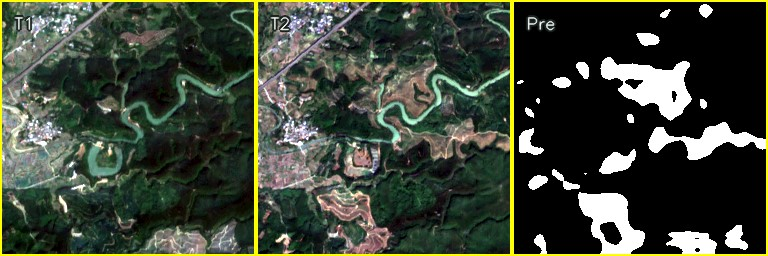

# Weakly Supervised Bi-Temporal Sentinel-2 Forest Change Detection with Incomplete Hansen Labels

## News

- **Release status:** The source code, study dataset, and model weights are not publicly available at this stage. They will be made available through this repository upon acceptance of the associated paper. Please stay tuned for updates.

## Overview

This study explores weakly supervised forest change detection using bi-temporal Sentinel-2 imagery and incomplete labels derived from the Hansen Global Forest Change (GFC) product.

The framework takes images of the same area acquired at two time points as paired inputs and uses Hansen-derived labels as weak supervision to produce forest change predictions. An associated platform supports visual inspection and presentation of the detection results.

*Bi-temporal Sentinel-2 imagery and the corresponding predicted forest change mask.*

## Dataset & Task

- **Input:** Bi-temporal Sentinel-2 imagery at 10 m spatial resolution, covering the same geographic area.
- **Weak supervision:** Incomplete labels derived from the Hansen Global Forest Change (GFC) product at 30 m spatial resolution.
- **Study areas:** Selected regions with extensive forest cover.
- **Task:** Forest change detection between two observation times.

The dataset prepared for this study is not currently released. Dataset access information will be provided through this repository upon paper acceptance.

## Contact

Questions and academic discussions are welcome. Please contact us at [zengrong186@163.com](mailto:zengrong186@163.com).
